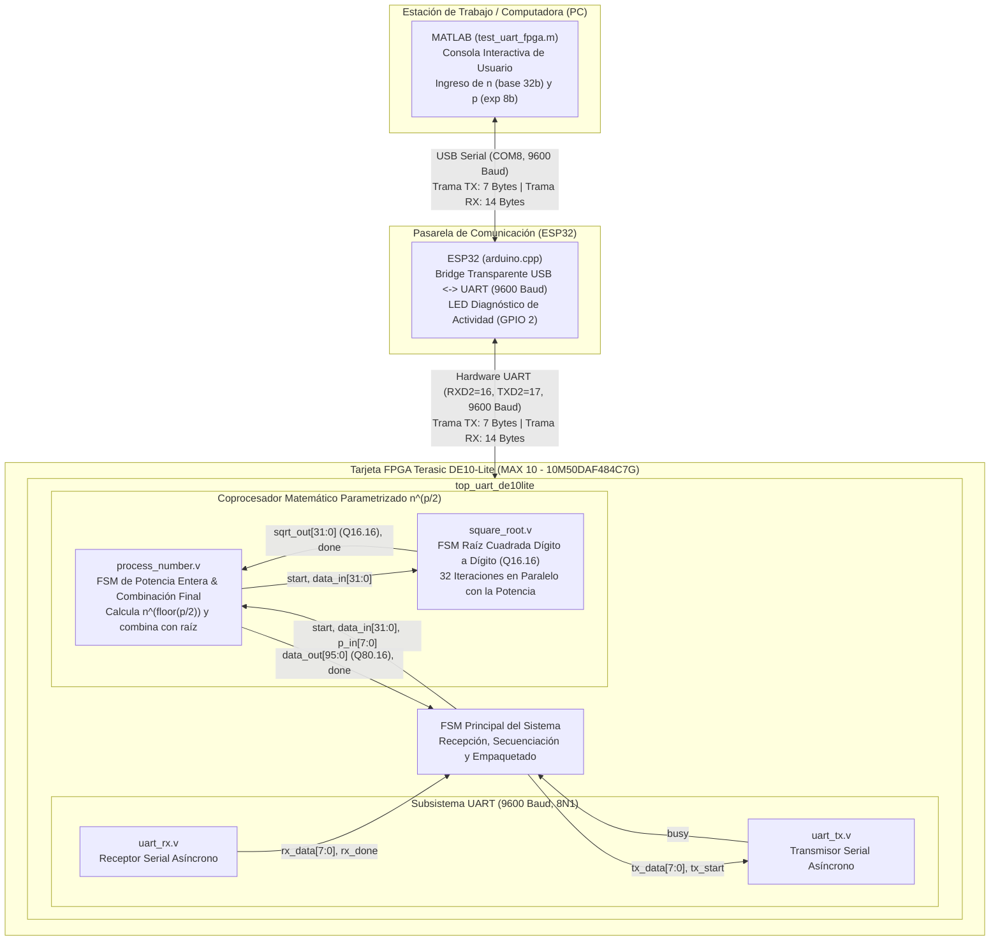
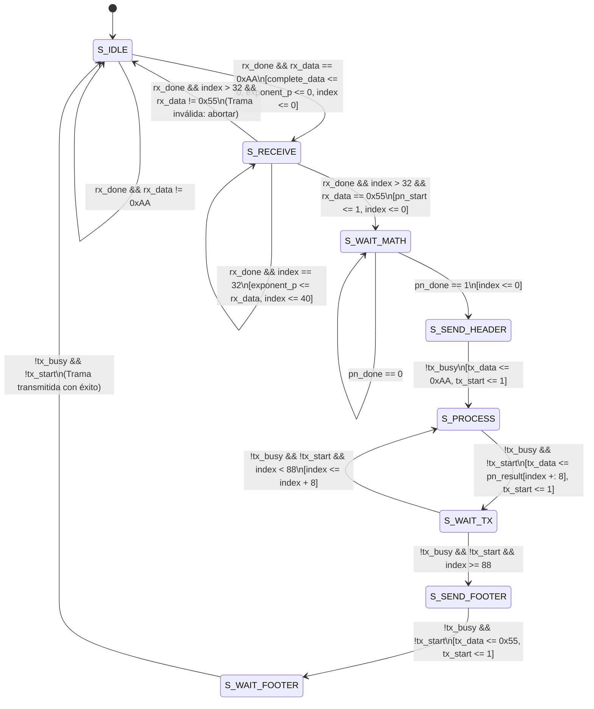
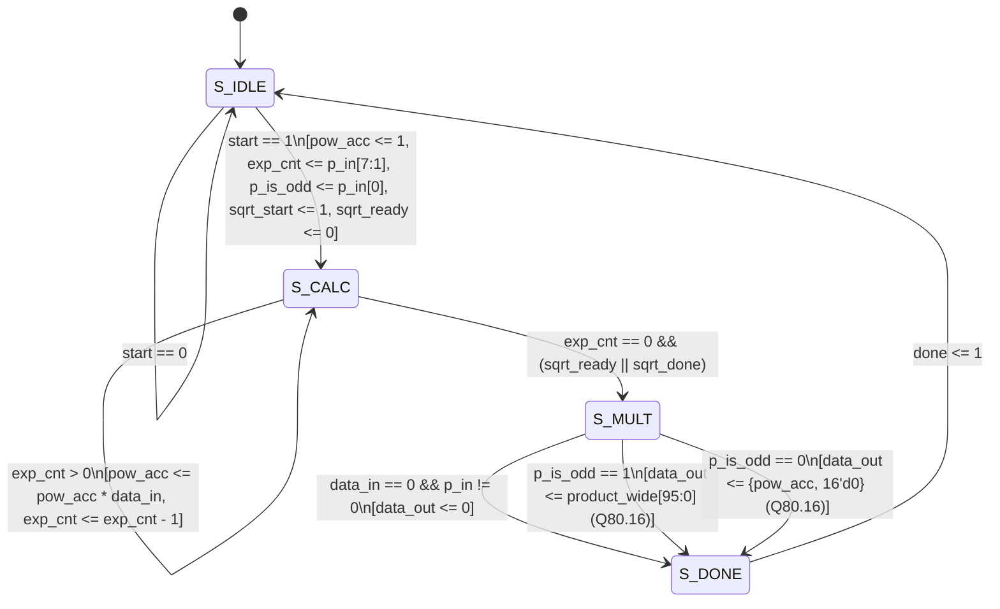
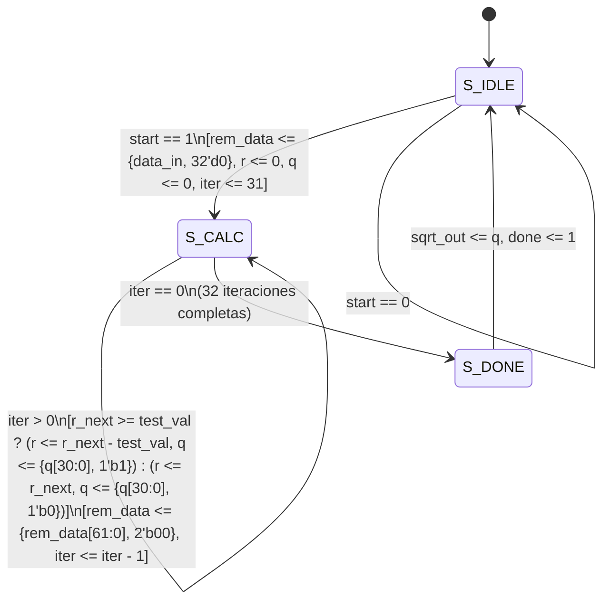
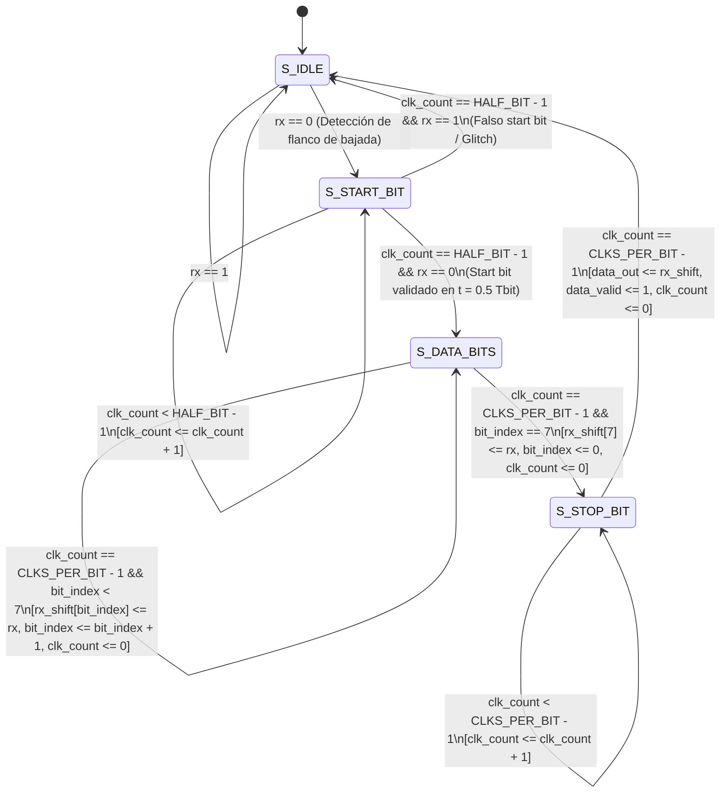
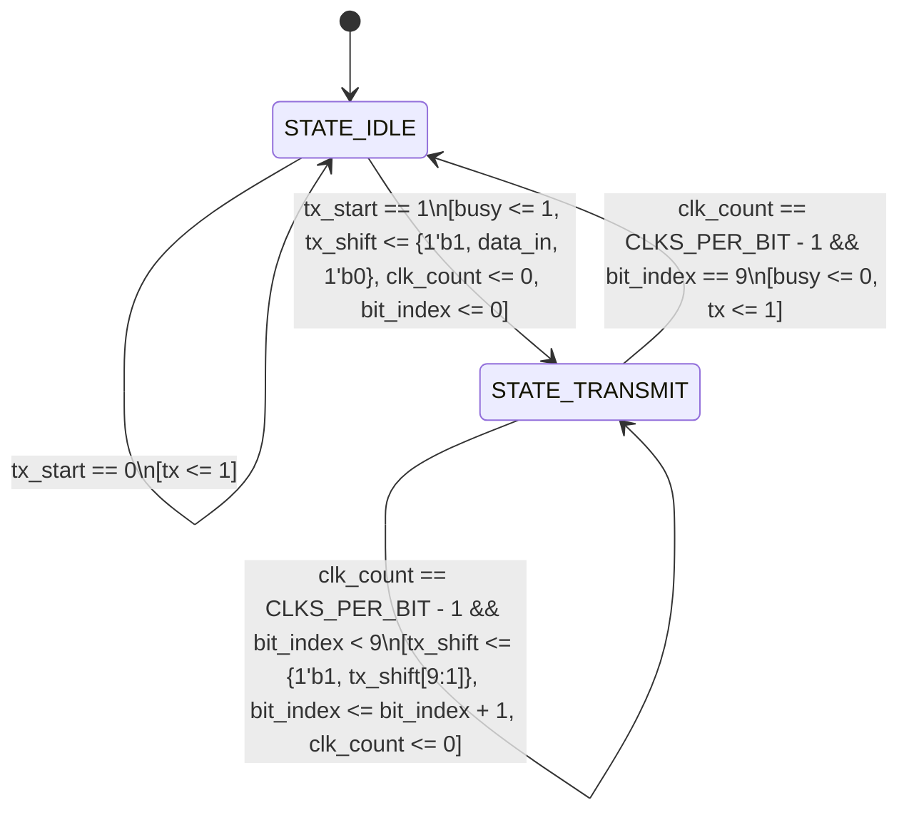

# Práctica 4: Coprocesador Matemático FPGA $n^{p/2}$ con Interfaz UART y Pasarela ESP32

**Institución:** Universidad de las Américas Puebla (UDLAP)  
**Curso:** Sistemas Embebidos
**Plataforma Hardware:** Tarjeta FPGA Terasic DE10-Lite (Intel MAX 10 `10M50DAF484C7G`)  
**Microcontrolador Intermedio:** Espressif ESP32 (Puente transparente USB-UART con LED de diagnóstico)  
**Consola de Usuario:** MATLAB R2020a+ (`test_uart_fpga.m`)  
**Frecuencia de Reloj FPGA:** 50 MHz (`CLOCK_50`)  
**Protocolo Serial:** UART a 9600 Baudios (8N1: 8 bits de datos, sin paridad, 1 bit de parada)

---

## 1. Descripción General del Proyecto

Este proyecto implementa un acelerador de hardware (coprocesador aritmético parametrizado) en Verilog HDL sobre una FPGA Intel MAX 10. El sistema calcula de forma digital la función matemática generalizada de potencias fraccionarias:

$$f(n, p) = n^{p/2} = n^{\lfloor p/2 \rfloor} \cdot \left(\sqrt{n}\right)^{p \pmod 2}$$

donde:
- $n$ es la **base entera sin signo** de 32 bits ($n \in [0, \, 2^{32}-1]$).
- $p$ es el **exponente entero sin signo** de 8 bits ($p \in [0, \, 255]$).
- El resultado se entrega en un bus de **96 bits** en formato de punto fijo **Q80.16** (80 bits para la parte entera y 16 bits para la parte fraccionaria).

### Arquitectura de Comunicación en Tres Niveles
El sistema opera a través de un esquema cliente-pasarela-coprocesador:



---

## 2. Especificación Matemática y Formato Numérico

### 2.1 Descomposición del Cálculo de $n^{p/2}$
Para optimizar el uso de recursos y latencia en la FPGA, el exponente $p$ de 8 bits se divide en dos componentes mediante aritmética de bits:
1. **Parte entera del exponente:** $\lfloor p / 2 \rfloor = p \gg 1$ (bits `p_in[7:1]`). Determina cuántas veces consecutivas se multiplica la base $n$ por el acumulador entero `pow_acc` (80 bits).
2. **Componente fraccionario (raíz cuadrada):** Determinado por el bit menos significativo $p \pmod 2 = p[0]$ (`p_is_odd`):
   - **Si $p$ es par (`p_is_odd == 0`):** El resultado es un entero puro $n^{p/2}$. No requiere multiplicación con la raíz; el acumulador entero `pow_acc` se alinea a la izquierda insertando 16 ceros en los bits fraccionarios:
     $$\text{data\\_out} = \{\text{pow\\_acc}[79:0], \, 16'd0\}$$
   - **Si $p$ es impar (`p_is_odd == 1`):** El resultado requiere el factor fraccionario $\sqrt{n}$. Para evitar truncamientos accidentales de ancho por parte del sintetizador de Verilog, el diseño implementa un multiplicador extendido explícitamente a 112 bits ($80 + 32$ bits):
     $$\text{product\\_wide}[111:0] = \{\{32\{1'b0\}\}, \, \text{pow\\_acc}\} \times \{\{80\{1'b0\}\}, \, \text{sqrt\\_res}\}$$
     Conservando en la salida los 96 bits inferiores correspondientes al formato **Q80.16**:
     $$\text{data\\_out}[95:0] = \text{product\\_wide}[95:0]$$
3. **Ejecución Concurrente:** El módulo [`process_number`](file:///Users/Azu/Desktop/School/UDLAP/9o/Sistemas%20Embebidos/Parcial3/Practica4/process_number.v) dispara el cálculo de raíz cuadrada en el módulo [`square_root`](file:///Users/Azu/Desktop/School/UDLAP/9o/Sistemas%20Embebidos/Parcial3/Practica4/square_root.v) en paralelo con las multiplicaciones de potencia entera. Una bandera interna `sqrt_ready` recuerda la finalización de la raíz en caso de que termine antes de concluir las iteraciones de la potencia entera (o viceversa), sincronizando ambas ramas aritméticas.
4. **Manejo de Casos Límite y Protección de Rango:**
   - Si $n = 0$ y $p > 0$, el módulo entrega de inmediato `data_out = 96'd0`.
   - Si $p = 0$, $n^0 = 1$ en formato Q80.16 (`0x00000000000000010000`).
   - Para el caso clásico de la práctica ($p = 5$), el sistema evalúa $n^{5/2} = n^2 \cdot \sqrt{n}$.
   - Rango dinámico: la parte entera admite valores hasta $2^{80}-1 \approx 1.2089 \times 10^{24}$. En MATLAB se valida que $n^{p/2} < 2^{80}$ antes de la transmisión para prevenir desbordamientos.

### 2.2 Representación en Punto Fijo (Q80.16)
El resultado final consta de 96 bits organizados de la siguiente forma:

| Rango de Bits | Ancho | Tipo | Descripción |
|---|---|---|---|
| `[95:16]` | 80 bits | Entero sin signo | Representa la parte entera de $n^{p/2}$ |
| `[15:0]` | 16 bits | Fraccionario | Representa la parte decimal $\frac{\text{valor}}{2^{16}} = \frac{\text{valor}}{65536}$ (resolución $\approx 1.5258 \times 10^{-5}$) |

Para obtener el valor decimal en software:
$$\text{Valor Decimal} = \frac{\text{data\\_out}[95:0]}{65536.0}$$

---

## 3. Protocolo de Comunicación UART

Tanto el enlace USB de la PC con el ESP32 como el canal físico entre el ESP32 y la FPGA operan a **9600 baudios**, formato **8N1** (8 bits de datos, sin paridad, 1 bit de parada).

### 3.1 Trama de Solicitud (MATLAB $\to$ ESP32 $\to$ FPGA) — 7 Bytes
El Host transmite un paquete de 7 bytes delimitado por cabecera y pie con el operando de 32 bits en formato Little-Endian y el exponente de 8 bits:

```
+----------+----------+----------+----------+----------+----------+----------+
| Byte 0   | Byte 1   | Byte 2   | Byte 3   | Byte 4   | Byte 5   | Byte 6   |
+----------+----------+----------+----------+----------+----------+----------+
| 0xAA     | n[7:0]   | n[15:8]  | n[23:16] | n[31:24] | p[7:0]   | 0x55     |
| (Header) | Base LSB | Base     | Base     | Base MSB | Exponente| (Footer) |
+----------+----------+----------+----------+----------+----------+----------+
```

### 3.2 Trama de Respuesta (FPGA $\to$ ESP32 $\to$ MATLAB) — 14 Bytes
La FPGA responde con una trama de 14 bytes conteniendo el resultado de 96 bits en formato Little-Endian:

```
+----------+-------------------------------------------------------------+----------+
| Byte 0   | Bytes 1 .. 12 (96 bits en Q80.16, Little-Endian)           | Byte 13  |
+----------+-------------------------------------------------------------+----------+
| 0xAA     | Byte 1: pn_result[7:0]   (Fracción LSB)                     | 0x55     |
| (Header) | Byte 2: pn_result[15:8]  (Fracción MSB)                     | (Footer) |
|          | Byte 3 .. 12: pn_result[23:16] a [95:88] (Parte Entera)    |          |
+----------+-------------------------------------------------------------+----------+
```

---

## 4. Máquinas de Estados Finitas (FSM)

Todos los módulos secuenciales clave del hardware implementan Máquinas de Estados Finitas (FSM). A continuación se documenta en detalle el funcionamiento, transiciones y diagrama de cada una.

---

### 4.1 FSM del Módulo Superior (`top_uart_de10lite.v`)

El módulo [`top_uart_de10lite`](file:///Users/Azu/Desktop/School/UDLAP/9o/Sistemas%20Embebidos/Parcial3/Practica4/top_uart_de10lite.v) actúa como el secuenciador maestro del sistema. Implementa una FSM de **8 estados** (registro `state` de 3 bits) encargada de validar la trama entrante, disparar el coprocesador y serializar los 12 bytes del resultado hacia el transmisor UART.

#### Diagrama de Estados:



#### Descripción de Estados:

| Estado | Código | Función / Comportamiento |
|---|---|---|
| `S_IDLE` | `3'b000` | Modo de espera. Al recibir el byte delimitador `0xAA` vía `rx_done`, reinicia el índice `index <= 0`, limpia `complete_data <= 0` y `exponent_p <= 0`, transicionando a `S_RECEIVE`. |
| `S_RECEIVE` | `3'b001` | **Recepción de trama de 7 bytes:** Si `index < 32`, acumula los 4 bytes de la base $n$ (`complete_data[index +: 8]`). Al alcanzar `index == 32`, captura el 5to byte en `exponent_p` y avanza a `index <= 40`. En el siguiente ciclo de recepción (`index == 40`), valida que el byte de cierre sea `0x55`. Si es correcto, activa `pn_start <= 1` y avanza a `S_WAIT_MATH`; si no es `0x55`, descarta la trama por malformación y regresa a `S_IDLE`. |
| `S_WAIT_MATH` | `3'b010` | Espera el pulso de finalización `pn_done` del coprocesador `process_number`. Al detectarlo, reinicia `index <= 0` y avanza a `S_SEND_HEADER`. |
| `S_SEND_HEADER` | `3'b011` | Cuando el transmisor UART está disponible (`!tx_busy`), carga `0xAA` en `tx_data`, pulsa `tx_start <= 1` y avanza a `S_PROCESS`. |
| `S_PROCESS` | `3'b100` | Carga el byte correspondiente `pn_result[index +: 8]` en `tx_data`, pulsa `tx_start <= 1` y pasa a `S_WAIT_TX`. |
| `S_WAIT_TX` | `3'b101` | Aguarda que el transmisor finalice el byte actual. Si `index < 88`, suma 8 al índice y regresa a `S_PROCESS` para el siguiente byte; si los 12 bytes ya fueron cargados (`index == 88`), avanza a `S_SEND_FOOTER`. |
| `S_SEND_FOOTER` | `3'b110` | Carga `0x55` en `tx_data`, pulsa `tx_start <= 1` y avanza a `S_WAIT_FOOTER`. |
| `S_WAIT_FOOTER` | `3'b111` | Aguarda a que el bit de parada del byte de cierre termine de transmitirse y retorna al estado de reposo `S_IDLE`. |

---

### 4.2 FSM del Coprocesador Parametrizado (`process_number.v`)

El módulo [`process_number`](file:///Users/Azu/Desktop/School/UDLAP/9o/Sistemas%20Embebidos/Parcial3/Practica4/process_number.v) calcula $n^{p/2}$ combinando acumulación de potencias enteras y la raíz cuadrada concurrente. Implementa una FSM de **4 estados** (registro `state` de 2 bits).

#### Diagrama de Estados:



#### Descripción de Estados:

| Estado | Código | Función / Comportamiento |
|---|---|---|
| `S_IDLE` | `2'b00` | Reposo. Al recibir `start`: inicializa `pow_acc <= 80'd1`, extrae el conteo de multiplicaciones enteras `exp_cnt <= p_in[7:1]`, almacena la bandera de paridad `p_is_odd <= p_in[0]`, dispara la raíz cuadrada concurrente `sqrt_start <= 1`, limpia `sqrt_ready <= 0` y pasa a `S_CALC`. |
| `S_CALC` | `2'b01` | **Cálculo concurrente:** Si `exp_cnt > 0`, multiplica en cada ciclo `pow_acc <= pow_acc * data_in` y decrementa `exp_cnt`. Simultáneamente, monitorea la señal `sqrt_done` del módulo de raíz cuadrada registrándola en la bandera `sqrt_ready`. Cuando **ambos** procesos terminan (`exp_cnt == 0` y `sqrt_ready \|\| sqrt_done`), transiciona a `S_MULT`. |
| `S_MULT` | `2'b10` | **Resolución del formato final:** Si $n = 0$ ($p > 0$), asigna `data_out <= 0`. Si $p$ es impar, utiliza el multiplicador de precisión extendida a 112 bits (`product_wide = {{32{1'b0}}, pow_acc} * {{80{1'b0}}, sqrt_res}`) y asigna `data_out <= product_wide[95:0]` preservando el formato Q80.16 sin truncamientos. Si $p$ es par, alinea el entero a Q80.16 desplazándolo 16 bits (`{pow_acc, 16'd0}`). Avanza a `S_DONE`. |
| `S_DONE` | `2'b11` | Genera un pulso activo en alto de un ciclo de reloj en `done <= 1` y retorna a `S_IDLE`. |

---

### 4.3 FSM del Módulo de Raíz Cuadrada (`square_root.v`)

El módulo [`square_root`](file:///Users/Azu/Desktop/School/UDLAP/9o/Sistemas%20Embebidos/Parcial3/Practica4/square_root.v) implementa el algoritmo digital de extracción de raíz cuadrada no restaurativa por sustracciones y desplazamientos bit a bit. Utiliza una FSM de **3 estados** (registro `state` de 2 bits) que ejecuta 32 iteraciones exactas.

#### Diagrama de Estados:



#### Fundamento del Algoritmo:
1. **Extensión Fraccionaria:** Se concatenan 32 ceros a la derecha del número de entrada (`rem_data <= {data_in, 32'd0}`), lo que asegura una resolución de 16 bits enteros y 16 bits fraccionarios en el resultado.
2. **Prueba por Pares de Bits:** En cada iteración:
   - `r_next = {r[31:0], rem_data[63:62]}`
   - `test_val = {q, 2'b01}`
   - Si `r_next >= test_val`, el nuevo bit de raíz es `1` y `r <= r_next - test_val`.
   - Si `r_next < test_val`, el nuevo bit de raíz es `0` y `r <= r_next`.
3. Al término de 32 iteraciones (`iter` decrece de 31 a 0), el registro `q` contiene exactamente el valor en **Q16.16**:
   - `q[31:16]`: Parte entera de $\sqrt{n}$
   - `q[15:0]`: Parte fraccionaria de $\sqrt{n}$

---

### 4.4 FSM del Receptor UART (`uart_rx.v`)

El módulo [`uart_rx`](file:///Users/Azu/Desktop/School/UDLAP/9o/Sistemas%20Embebidos/Parcial3/Practica4/uart_rx.v) implementa un receptor asíncrono con sobremuestreo y validación en el centro del bit de inicio. Consta de una FSM de **4 estados** (registro `state` de 2 bits).

#### Diagrama de Estados:



#### Descripción de Estados:

| Estado | Código | Función / Comportamiento |
|---|---|---|
| `S_IDLE` | `2'b00` | Línea en reposo (`rx == 1`). Al detectar flanco de bajada (`rx == 0`), pasa a `S_START_BIT`. |
| `S_START_BIT` | `2'b01` | Cuenta hasta el centro del bit (`HALF_BIT = 2604` ciclos a 50 MHz). Si la línea permanece en bajo, confirma el bit de inicio y pasa a `S_DATA_BITS`; de lo contrario, se descarta por ruido y regresa a `S_IDLE`. |
| `S_DATA_BITS` | `2'b10` | Muestrea secuencialmente cada uno de los 8 bits en el centro de su ventana (`CLKS_PER_BIT = 5208` ciclos), desplazándolos en `rx_shift` de LSB a MSB. |
| `S_STOP_BIT` | `2'b11` | Aguarda el tiempo del bit de parada, asigna `data_out <= rx_shift`, pulsa `data_valid <= 1` durante un ciclo de reloj y regresa a `S_IDLE`. |

---

### 4.5 Máquina de Control del Transmisor UART (`uart_tx.v`)

El módulo [`uart_tx`](file:///Users/Azu/Desktop/School/UDLAP/9o/Sistemas%20Embebidos/Parcial3/Practica4/uart_tx.v) serializa bytes hacia el pin físico `UART_TX`. Opera mediante un autómata de **2 modos de operación** gobernado por el registro `busy` y un registro de desplazamiento de 10 bits (`tx_shift`).

#### Diagrama de Estados:



#### Funcionamiento:
- **Reposo (`busy == 0`):** La línea `tx` se mantiene en alto lógico (`1`). Al recibir el pulso `tx_start`, se carga en el registro de 10 bits la trama serial completa `{1'b1, data_in, 1'b0}` (Bit de parada `1`, 8 bits de datos, Bit de inicio `0`), se activa `busy <= 1` y se limpian contadores.
- **Transmisión (`busy == 1`):** La línea `tx` expone `tx_shift[0]`. Cada `CLKS_PER_BIT` ciclos (5208 ciclos a 9600 baudios), el registro se desplaza a la derecha insertando un `1` en el MSB. Tras 10 desplazamientos (`bit_index == 9`), se desactiva `busy <= 0` y la línea regresa al reposo.

---

## 5. Estructura de Archivos del Proyecto

| Archivo | Descripción | Contiene FSM |
|---|---|:---:|
| [`top_uart_de10lite.v`](file:///Users/Azu/Desktop/School/UDLAP/9o/Sistemas%20Embebidos/Parcial3/Practica4/top_uart_de10lite.v) | Módulo Top-Level (Controlador maestro, FSM de 8 estados, UART y Coprocesador) | **Sí (8 estados)** |
| [`process_number.v`](file:///Users/Azu/Desktop/School/UDLAP/9o/Sistemas%20Embebidos/Parcial3/Practica4/process_number.v) | FSM del Coprocesador Parametrizado para $n^{p/2}$ con cálculo concurrente | **Sí (4 estados)** |
| [`square_root.v`](file:///Users/Azu/Desktop/School/UDLAP/9o/Sistemas%20Embebidos/Parcial3/Practica4/square_root.v) | FSM de Raíz Cuadrada no restaurativa dígito a dígito en Q16.16 (32 iteraciones) | **Sí (3 estados)** |
| [`uart_rx.v`](file:///Users/Azu/Desktop/School/UDLAP/9o/Sistemas%20Embebidos/Parcial3/Practica4/uart_rx.v) | FSM del Receptor UART con validación de Start Bit en centro de bit | **Sí (4 estados)** |
| [`uart_tx.v`](file:///Users/Azu/Desktop/School/UDLAP/9o/Sistemas%20Embebidos/Parcial3/Practica4/uart_tx.v) | Autómata de Transmisión UART con registro de desplazamiento de 10 bits | **Sí (2 modos)** |
| [`tb_top.v`](file:///Users/Azu/Desktop/School/UDLAP/9o/Sistemas%20Embebidos/Parcial3/Practica4/tb_top.v) | Banco de pruebas completo para ModelSim / QuestaSim con tareas para $n$ y $p$ | No (Testbench) |
| [`arduino.cpp`](file:///Users/Azu/Desktop/School/UDLAP/9o/Sistemas%20Embebidos/Parcial3/Practica4/arduino.cpp) | Firmware del ESP32: Pasarela transparente USB $\leftrightarrow$ UART con LED diagnóstico | No (Firmware) |
| [`test_uart_fpga.m`](file:///Users/Azu/Desktop/School/UDLAP/9o/Sistemas%20Embebidos/Parcial3/Practica4/test_uart_fpga.m) | Consola interactiva en MATLAB para envío de $n$ y $p$ con cálculo de error | No (Script) |
| [`README.md`](file:///Users/Azu/Desktop/School/UDLAP/9o/Sistemas%20Embebidos/Parcial3/Practica4/README.md) | Documentación técnica integral del proyecto | No |

---

## 6. Verificación, Simulación y Pruebas

### 6.1 Simulación RTL en ModelSim / QuestaSim (`tb_top.v`)
El banco de pruebas [`tb_top.v`](file:///Users/Azu/Desktop/School/UDLAP/9o/Sistemas%20Embebidos/Parcial3/Practica4/tb_top.v) incluye la tarea `send_uart_frame_np(n_val, p_val)` para enviar tramas con base $n$ y exponente $p$, así como monitoreo en tiempo real de las transiciones de la FSM de la FPGA:

```bash
# Compilar todos los módulos Verilog
vlog top_uart_de10lite.v process_number.v square_root.v uart_rx.v uart_tx.v tb_top.v

# Ejecutar simulación
vsim -c tb_top_uart_de10lite -do "run -all; quit"
```

### 6.2 Casos de Prueba Típicos ($n^{p/2}$)

| Base $n$ | Exponente $p$ | Expresión Evaluada | Valor Teórico | Hexadecimal FPGA (Q80.16) | Parte Entera | Parte Fraccionaria | Resultado FPGA | Error Absoluto |
|:---:|:---:|:---:|:---:|:---:|:---:|:---:|:---:|:---:|
| **10** | **5** | $10^2 \cdot \sqrt{10}$ | **316.227766** | `0x000000000000013C3A4F` | 316 | 14927 / 65536 | **316.227783** | $1.7 \times 10^{-5}$ |
| **50** | **5** | $50^2 \cdot \sqrt{50}$ | **17677.669530** | `0x000000000000450DAB65` | 17677 | 43877 / 65536 | **17677.669510** | $2.0 \times 10^{-5}$ |
| **85** | **5** | $85^2 \cdot \sqrt{85}$ | **66610.665400** | `0x0000000000010432AA5A` | 66610 | 43610 / 65536 | **66610.665390** | $1.0 \times 10^{-5}$ |
| **144**| **5** | $144^2 \cdot 12$ | **248832.000000** | `0x000000000003CC000000` | 248832 | 0 / 65536 | **248832.000000** | **0.000000** |
| **4**  | **4** | $4^{4/2} = 4^2$ | **16.000000** | `0x00000000000000100000` | 16 | 0 / 65536 | **16.000000** | **0.000000** |
| **9**  | **3** | $9^1 \cdot \sqrt{9} = 27$ | **27.000000** | `0x000000000000001B0000` | 27 | 0 / 65536 | **27.000000** | **0.000000** |

> [!NOTE]
> Cuando el exponente $p$ es par o cuando la base $n$ es un cuadrado perfecto, el componente fraccionario es exactamente cero (`0x0000`), demostrando error cero. En casos con raíz irracional, el error absoluto se mantiene estrictamente por debajo de la resolución fraccionaria de 16 bits ($\frac{1}{65536} \approx 1.5258 \times 10^{-5}$).

---

### 6.3 Firmware de la Pasarela ESP32 (`arduino.cpp`)

El microcontrolador ESP32 actúa como un puente bidireccional transparente:
- **`Serial` (USB):** Conecta a la PC a 9600 baudios. Recibe la trama de 7 bytes desde MATLAB y reenvía los 14 bytes devueltos por la FPGA.
- **`Serial2` (Hardware UART):** Conecta directamente con la FPGA a 9600 baudios (8N1):
  - **Pin GPIO 16 (`RXD2`):** Conectar a `UART_TX` de la FPGA.
  - **Pin GPIO 17 (`TXD2`):** Conectar a `UART_RX` de la FPGA.
  - **GND:** Referencia común obligatoria entre el ESP32 y la placa DE10-Lite.
- **LED Diagnóstico (`LED_PIN = 2`):** Se enciende automáticamente al remitir la trama a la FPGA y permanece encendido mientras aguarda los 14 bytes de respuesta, apagándose al completar la transacción.

---

### 6.4 Consola Interactiva en MATLAB (`test_uart_fpga.m`)

El script interactivo [`test_uart_fpga.m`](file:///Users/Azu/Desktop/School/UDLAP/9o/Sistemas%20Embebidos/Parcial3/Practica4/test_uart_fpga.m) permite evaluar el hardware en tiempo real:
1. **Configuración del Puerto:** Abre la conexión serial en el puerto configurado (`PORT = "COM3"` por defecto en Windows o `/dev/ttyUSB0` / `/dev/cu.usbserial-*` en Linux/macOS) a 9600 baudios, aguardando 2.5 s para el arranque limpio del ESP32 y purgando residuos del búfer (`flush`).
2. **Validación de Entradas del Usuario:**
   - Solicita la base $n \ge 0$ (número entero finito en el rango $[0, \, 2^{32}-1]$, o valor negativo para finalizar).
   - Solicita el numerador $p$ con denominador fijo en 2 ($p/2$), validando que sea un entero estricto entre 1 y 255.
3. **Protección Previa contra Desbordamiento (Overflow Guard):** Calcula previamente el valor teórico $n^{p/2}$ y verifica que no exceda la capacidad entera de 80 bits del formato Q80.16 ($n^{p/2} < 2^{80}$); si excede, alerta al usuario antes de transmitir y solicita nuevos operandos.
4. **Construcción y Transmisión de Trama:** Empaqueta $n$ en 4 bytes Little-Endian, anexa $p$ y envía la trama de 7 bytes: `[0xAA, n[7:0], n[15:8], n[23:16], n[31:24], p[7:0], 0x55]`.
5. **Máquina de Recepción Robusta:**
   - Sincroniza buscando el delimitador de cabecera `0xAA` descartando cualquier byte espurio previo, bajo una ventana de timeout de 1.5 s.
   - Aguarda y lee los 13 bytes restantes (12 bytes de payload en Q80.16 + 1 byte de footer `0x55`).
6. **Decodificación y Métricas de Precisión:**
   - Reconstruye el número de 96 bits ponderando los bytes en Little-Endian.
   - Extrae la parte fraccionaria (`frac_raw / 65536.0`) y la parte entera (`int_part`).
   - Compara con el valor teórico en doble precisión de MATLAB `n_double ^ (double(p_byte) / 2.0)` y reporta en consola con 6 dígitos decimales el resultado FPGA, valor analítico y error absoluto.

---

## 7. Mapeo de Pines en la Tarjeta Terasic DE10-Lite

Para la síntesis en Intel Quartus Prime, se utilizan las siguientes asignaciones de pines en el archivo de restricciones (`.qsf`):

| Puerto Verilog | Tipo | Pin FPGA MAX 10 | Descripción en Placa DE10-Lite |
|---|---|---|---|
| `CLOCK_50` | Input (3.3V LVTTL) | `PIN_P11` | Oscilador de reloj de 50 MHz del sistema |
| `RESET_N` | Input (3.3V LVTTL) | `PIN_B8` | Pulsador activo en bajo `KEY[0]` |
| `UART_RX` | Input (3.3V LVTTL) | `PIN_V10` | GPIO [0] |
| `UART_TX` | Output (3.3V LVTTL) | `PIN_W10` | GPIO [1] |

> [!IMPORTANT]
> Los pines del conector de expansión GPIO y de la cabecera Arduino en la tarjeta DE10-Lite operan a **3.3V LVTTL**. Dado que el ESP32 opera de forma nativa a 3.3V en sus líneas lógicas, la conexión directa de los pines TX/RX entre ambas tarjetas es totalmente segura.

## 8. Instalación y ejecución del proyecto

### 8.1 Requisitos

Para ejecutar el proyecto se necesita:
- FPGA Terasic DE10-Lite.
- Microcontrolador ESP32.
- Cables USB y jumpers (cables Dupont).
- Intel Quartus Prime.
- Arduino IDE.
- MATLAB.

---

### 8.2 Configuración y programación de la FPGA

1. Abrir el proyecto de la FPGA en Quartus Prime.
2. Verificar que la entidad principal (*Top-Level Entity*) sea `top_uart_de10lite`.
3. Comprobar que estén incluidos los módulos Verilog:
   - `top_uart_de10lite.v`
   - `process_number.v`
   - `square_root.v`
   - `uart_rx.v`
   - `uart_tx.v`
4. Asignar los pines correspondientes siguiendo la tabla de mapeo.
5. Ejecutar **Processing → Start Compilation**.
6. Si la compilación termina correctamente, cargar el archivo en la FPGA utilizando la herramienta **Programmer**.

---

### 8.3 Configuración del ESP32

El ESP32 funciona como una pasarela bidireccional entre MATLAB y la FPGA.

1. Abrir el código del ESP32 en Arduino IDE.
2. Seleccionar la tarjeta ESP32 correspondiente y el puerto COM asignado.
3. Verificar que la comunicación UART esté configurada a **9600 baudios**.
4. Cargar el programa en el ESP32.

---

### 8.4 Conexiones físicas

Realizar las siguientes conexiones entre el ESP32 y la FPGA:

| ESP32 | FPGA DE10-Lite | Descripción |
| :--- | :--- | :--- |
| **GPIO 17 (TXD2)** | `UART_RX` (`PIN_V10`) | Envío de datos hacia la FPGA. |
| **GPIO 16 (RXD2)** | `UART_TX` (`PIN_W10`) | Recepción de datos desde la FPGA. |
| **GND** | `GND` | Referencia eléctrica común. |

---

### 8.5 Ejecución desde MATLAB

1. Conectar el ESP32 a la computadora mediante USB.
2. Identificar el puerto COM asignado en el sistema operativo y actualizarlo en la variable correspondiente dentro del archivo `test_uart_fpga.m`.
3. Abrir y ejecutar el script desde MATLAB.
4. Introducir los valores de entrada solicitados:
   - **$n$**: número base (entero de 32 bits).
   - **$p$**: numerador del exponente (entero de 8 bits).
5. MATLAB envía la trama de datos al ESP32, el cual los transmite de manera transparente a la FPGA.
6. La FPGA procesa la solicitud y devuelve el resultado a través de UART.
7. MATLAB recibe, interpreta y muestra el resultado obtenido en formato decimal, junto con el valor teórico esperado y el error absoluto.

---

### 8.6 Secuencia recomendada de ejecución

Para evitar inconvenientes durante las pruebas, se recomienda seguir estrictamente este orden:

1. Compilar y programar la FPGA mediante Quartus Prime.
2. Cargar el firmware al ESP32 mediante Arduino IDE.
3. Realizar las conexiones físicas entre el ESP32 y la FPGA.
4. Conectar el ESP32 a la computadora mediante USB.
5. Identificar y configurar el puerto COM en el script de MATLAB.
6. Ejecutar el archivo `test_uart_fpga.m`.
7. Introducir los valores de entrada y observar el comportamiento del sistema.
8. Comparar el resultado devuelto por la FPGA con el valor teórico calculado por MATLAB.

---

## 9. Solución de problemas comunes

| Problema | Posible causa | Solución |
| :--- | :--- | :--- |
| **MATLAB no puede abrir el puerto COM** | Puerto incorrecto o actualmente utilizado por otro software. | Verificar el puerto asignado en el Administrador de dispositivos y cerrar cualquier otra aplicación que lo esté utilizando. |
| **MATLAB no recibe respuesta** | ESP32 desconectado, FPGA sin programar o conexiones UART erróneas. | Revisar la alimentación de las tarjetas, la programación lógica y la correcta conexión cruzada de TX/RX y GND. |
| **Los datos recibidos son incorrectos** | Discrepancia en la estructura de las tramas o configuración serial. | Comprobar que ambos dispositivos operen a 9600 baudios, formato 8N1 y utilicen el mismo orden de bytes. |
| **Quartus muestra errores de compilación** | Archivos fuente faltantes, entidad principal mal definida o restricciones inválidas. | Revisar la inclusión de todos los módulos en el proyecto y las asignaciones descritas en el archivo. |
| **El resultado de la FPGA difiere del esperado** | Error físico de comunicación, truncamiento numérico o mala interpretación del formato Q80.16. | Revisar los bytes recibidos en la trama y verificar la función de conversión a decimal dentro de MATLAB. |
