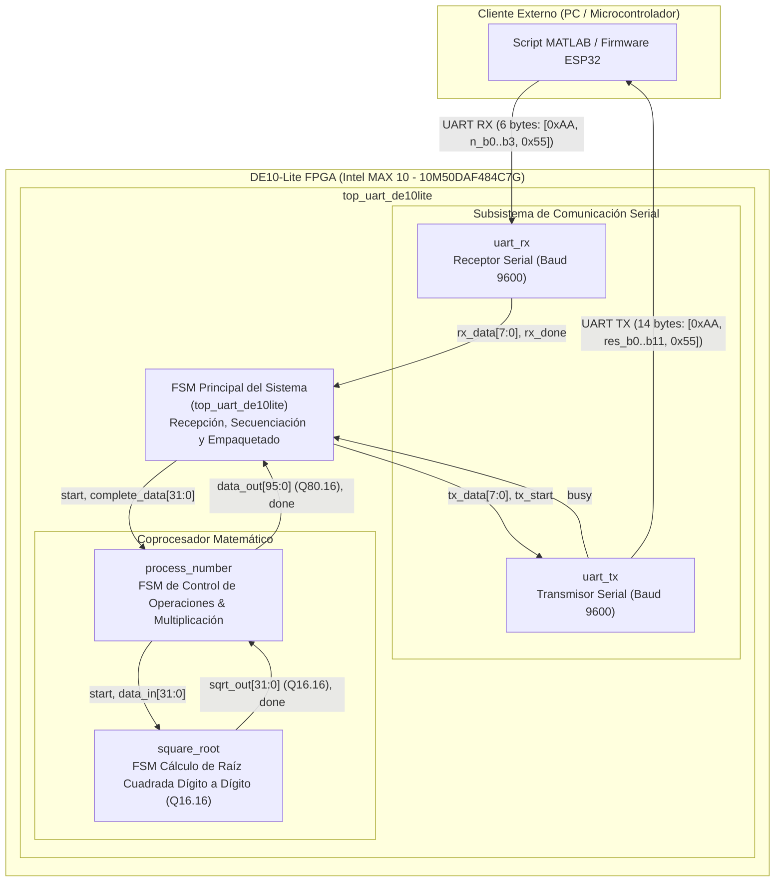
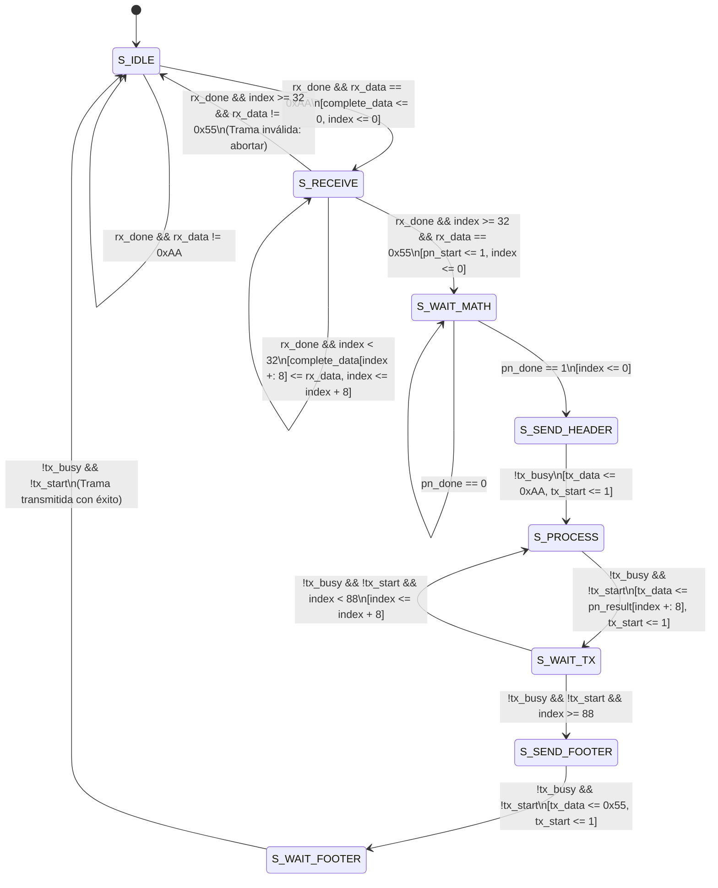
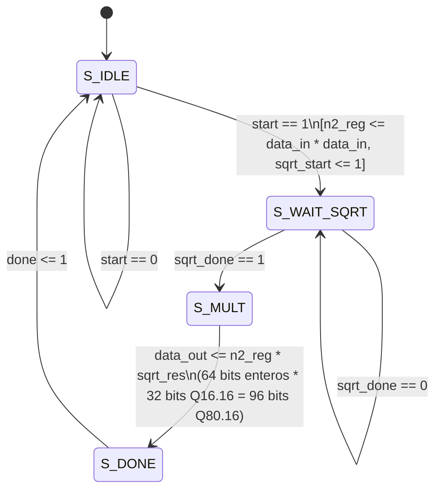
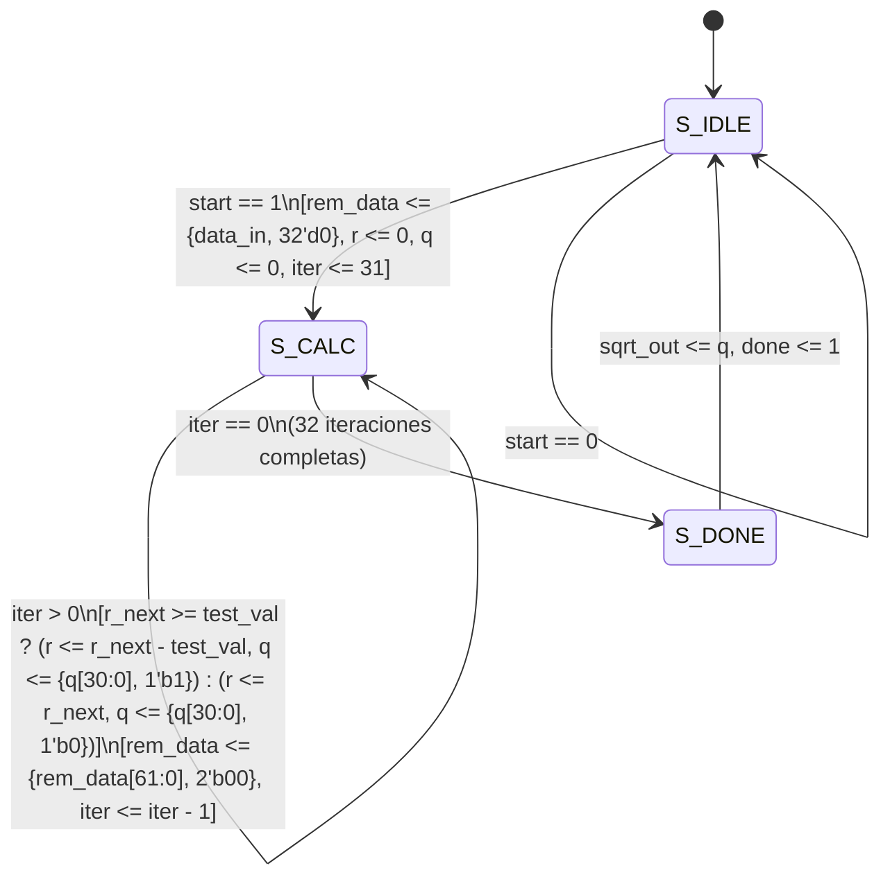
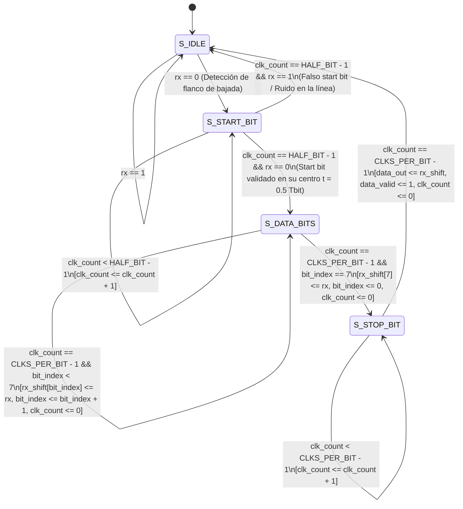
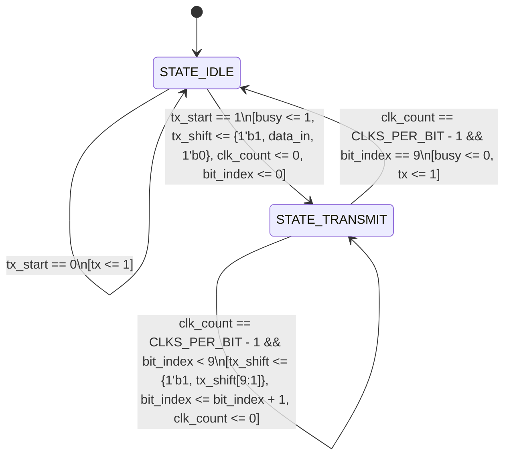

# Práctica 4: Coprocesador Matemático FPGA $n^{5/2}$ con Comunicación UART

**Institución:** Universidad de las Américas Puebla (UDLAP)  
**Curso:** Sistemas Embebidos (9º Semestre) — Parcial 3  
**Plataforma Hardware:** Tarjeta FPGA Terasic DE10-Lite (Intel MAX 10 `10M50DAF484C7G`)  
**Frecuencia de Reloj:** 50 MHz (`CLOCK_50`)  
**Protocolo Serial:** UART a 9600 Baudios (8N1: 8 bits de datos, sin paridad, 1 bit de parada)

---

## 1. Descripción General del Proyecto

Este proyecto implementa un acelerador de hardware (coprocesador aritmético) en lenguaje Verilog HDL sobre una FPGA Intel MAX 10. El sistema calcula la función matemática no lineal:

$$f(n) = n^{5/2} = n^2 \cdot \sqrt{n}$$

para cualquier entero positivo $n$ de 32 bits, entregando un resultado de alta precisión de **96 bits** en formato de punto fijo **Q80.16** (80 bits para la parte entera y 16 bits para la parte fraccionaria).

La comunicación bidireccional entre la FPGA y sistemas externos (microcontrolador ESP32/Arduino o computadora mediante MATLAB) se realiza a través de un enlace UART robusto con protocolo delimitado por cabecera (`0xAA`) y pie (`0x55`).



---

## 2. Especificación Matemática y Formato Numérico

### 2.1 Descomposición del Cálculo
El cálculo de $n^{5/2}$ se descompone en hardware en dos etapas optimizadas:
1. **Cálculo cuadrático entero ($n^2$):** Multiplicación de 32 bits $\times$ 32 bits que produce un entero sin signo de 64 bits ($n^2$).
2. **Cálculo de raíz cuadrada ($\sqrt{n}$):** Algoritmo no restaurativo dígito a dígito de 32 iteraciones. Extiende los 32 bits enteros de entrada con 32 ceros a la derecha, produciendo un resultado de 32 bits en formato **Q16.16** (16 bits de parte entera y 16 bits de parte fraccionaria).
3. **Multiplicación final ($n^2 \cdot \sqrt{n}$):** Multiplicación de un entero de 64 bits por un número Q16.16 de 32 bits:
   $$\text{Entero de 64 bits} \times \text{Q16.16 (32 bits)} = \text{Q80.16 (96 bits)}$$

### 2.2 Representación en Punto Fijo (Q80.16)
El resultado final consta de 96 bits organizados de la siguiente forma:

| Rango de Bits | Ancho | Tipo | Descripción |
|---|---|---|---|
| `[95:16]` | 80 bits | Entero sin signo | Representa la parte entera de $n^{5/2}$ |
| `[15:0]` | 16 bits | Fraccionario | Representa la parte decimal $\frac{\text{valor}}{2^{16}} = \frac{\text{valor}}{65536}$ (resolución $\approx 1.5258 \times 10^{-5}$) |

Para obtener el valor decimal real:
$$\text{Valor Real} = \frac{\text{data\_out}[95:0]}{65536.0}$$

---

## 3. Protocolo de Comunicación UART

Ambos canales (transmisión y recepción) operan bajo el estándar UART con formato **8N1** (8 bits de datos, sin bit de paridad, 1 bit de parada) a una velocidad de **9600 baudios** con reloj base de **50 MHz** ($\approx 5208$ ciclos de reloj por bit).

### 3.1 Trama de Solicitud (Host $\to$ FPGA) — 6 Bytes
El Host transmite un paquete de 6 bytes en formato Little-Endian:

```
+------------+------------+------------+------------+------------+------------+
| Byte 0     | Byte 1     | Byte 2     | Byte 3     | Byte 4     | Byte 5     |
+------------+------------+------------+------------+------------+------------+
| 0xAA       | n[7:0]     | n[15:8]    | n[23:16]   | n[31:24]   | 0x55       |
| (Header)   | LSB Datos  | Datos      | Datos      | MSB Datos  | (Footer)   |
+------------+------------+------------+------------+------------+------------+
```

### 3.2 Trama de Respuesta (FPGA $\to$ Host) — 14 Bytes
La FPGA responde con una trama de 14 bytes conteniendo el resultado en formato Little-Endian:

```
+----------+-------------------------------------------------------------+----------+
| Byte 0   | Bytes 1 .. 12 (96 bits en Q80.16, Little-Endian)           | Byte 13  |
+----------+-------------------------------------------------------------+----------+
| 0xAA     | Byte 1: pn_result[7:0]   (Fracción LSB)                     | 0x55     |
| (Header) | Byte 2: pn_result[15:8]  (Fracción MSB)                     | (Footer) |
|          | Byte 3 .. 12: pn_result[23:16] a [95:88] (Parte Entera)    |          |
+----------+-------------------------------------------------------------+----------+
```

---

## 4. Máquinas de Estados Finitas (FSM)

Todos los módulos secuenciales clave del diseño implementan Máquinas de Estados Finitas (FSM). A continuación se documenta en detalle el funcionamiento y diagrama de cada una.

---

### 4.1 FSM del Módulo Superior (`top_uart_de10lite.v`)

El módulo [`top_uart_de10lite`](file:///Users/Azu/Desktop/School/UDLAP/9o/Sistemas%20Embebidos/Parcial3/Practica4/top_uart_de10lite.v) actúa como el controlador central del chip. Implementa una FSM de **8 estados** (registro `state` de 3 bits) encargada de validar la trama entrante, disparar el coprocesador matemático y serializar los 12 bytes del resultado hacia el transmisor UART.

#### Diagrama de Estados:



#### Descripción de Estados:

| Estado | Código | Función / Comportamiento |
|---|---|---|
| `S_IDLE` | `3'b000` | Monitorea el receptor UART. Si `rx_done` se activa con `rx_data == 8'hAA`, inicializa registros y avanza a `S_RECEIVE`. |
| `S_RECEIVE` | `3'b001` | Acumula secuencialmente 4 bytes de datos (`n[31:0]`). Al completarse los 32 bits (`index == 32`), evalúa el siguiente byte: si es `0x55`, emite `pn_start <= 1` y pasa a `S_WAIT_MATH`; si no, descarta la trama regresando a `S_IDLE`. |
| `S_WAIT_MATH` | `3'b010` | Espera la señal de terminación `pn_done` emitida por el módulo `process_number`. Al completarse, reinicia `index <= 0` y avanza a `S_SEND_HEADER`. |
| `S_SEND_HEADER` | `3'b011` | Cuando el transmisor no está ocupado (`!tx_busy`), carga `0xAA` en `tx_data`, activa `tx_start <= 1` e inicia la transmisión de respuesta en `S_PROCESS`. |
| `S_PROCESS` | `3'b100` | Extrae la porción de 8 bits `pn_result[index +: 8]`, activa `tx_start <= 1` y avanza a `S_WAIT_TX`. |
| `S_WAIT_TX` | `3'b101` | Aguarda que el transmisor finalice el byte actual. Si `index < 88`, suma 8 al índice y regresa a `S_PROCESS` para el siguiente byte; si ya se transmitieron los 12 bytes (`index == 88`), salta a `S_SEND_FOOTER`. |
| `S_SEND_FOOTER` | `3'b110` | Carga el delimitador final `0x55` en `tx_data`, activa `tx_start <= 1` y avanza a `S_WAIT_FOOTER`. |
| `S_WAIT_FOOTER` | `3'b111` | Aguarda a que el bit de parada del byte de cierre termine de transmitirse (`!tx_busy && !tx_start`) y retorna al estado de reposo `S_IDLE`. |

---

### 4.2 FSM del Coprocesador Matemático (`process_number.v`)

El módulo [`process_number`](file:///Users/Azu/Desktop/School/UDLAP/9o/Sistemas%20Embebidos/Parcial3/Practica4/process_number.v) orquesta las operaciones aritméticas para evaluar $n^{5/2}$. Implementa una FSM de **4 estados** (registro `state` de 2 bits).

#### Diagrama de Estados:



#### Descripción de Estados:

| Estado | Código | Función / Comportamiento |
|---|---|---|
| `S_IDLE` | `2'b00` | En reposo. Al detectar el pulso `start`, calcula de inmediato $n^2 = \text{data\_in} \times \text{data\_in}$ (almacenado en `n2_reg` de 64 bits), dispara el módulo de raíz cuadrada con `sqrt_start <= 1` y pasa a `S_WAIT_SQRT`. |
| `S_WAIT_SQRT` | `2'b01` | Espera sincrónicamente a que el módulo `square_root` termine su cálculo iterativo (`sqrt_done == 1`). |
| `S_MULT` | `2'b10` | Realiza la multiplicación de 64 bits $\times$ 32 bits: `n2_reg * sqrt_res`. Dado que `sqrt_res` tiene 16 bits fraccionarios, el producto resultante de 96 bits preserva automáticamente el formato Q80.16. |
| `S_DONE` | `2'b11` | Genera un pulso activo en alto de un ciclo de reloj en `done <= 1` y retorna a `S_IDLE`. |

---

### 4.3 FSM del Módulo de Raíz Cuadrada (`square_root.v`)

El módulo [`square_root`](file:///Users/Azu/Desktop/School/UDLAP/9o/Sistemas%20Embebidos/Parcial3/Practica4/square_root.v) implementa el algoritmo digital de extracción de raíz cuadrada no restaurativa por sustracciones y desplazamientos bit a bit. Utiliza una FSM de **3 estados** (registro `state` de 2 bits) con 32 iteraciones exactas.

#### Diagrama de Estados:



#### Fundamento Matemático del Algoritmo:
1. **Extensión:** Para obtener 16 bits de resolución fraccionaria a partir de una entrada entera de 32 bits, se concatenan 32 ceros a la derecha: `rem_data <= {data_in, 32'd0}` (total 64 bits).
2. **Procesamiento por pares de bits:** En cada ciclo:
   - `r_next = {r[31:0], rem_data[63:62]}` (desplaza el residuo 2 bits e incorpora los siguientes dos bits del operando).
   - `test_val = {q, 2'b01}` (valor de prueba cuadrático formado por la raíz acumulada y `01`).
   - Si `r_next >= test_val`, el nuevo bit de raíz es `1` y el nuevo residuo es `r_next - test_val`.
   - Si `r_next < test_val`, el nuevo bit de raíz es `0` y el residuo permanece intacto.
3. Al finalizar 32 iteraciones (`iter` decrece de 31 a 0), el registro `q` contiene exactamente el valor en **Q16.16**:
   - `q[31:16]`: Parte entera de $\sqrt{n}$
   - `q[15:0]`: Parte fraccionaria de $\sqrt{n}$

---

### 4.4 FSM del Receptor UART (`uart_rx.v`)

El módulo [`uart_rx`](file:///Users/Azu/Desktop/School/UDLAP/9o/Sistemas%20Embebidos/Parcial3/Practica4/uart_rx.v) implementa un receptor UART asíncrono con sobremuestreo y validación central del bit de inicio. Consta de una FSM de **4 estados** (registro `state` de 2 bits).

#### Diagrama de Estados:



#### Descripción de Estados:

| Estado | Código | Función / Comportamiento |
|---|---|---|
| `S_IDLE` | `2'b00` | Línea en reposo (alta). Cuando detecta un nivel bajo (`rx == 0`), reinicia contadores y entra a `S_START_BIT`. |
| `S_START_BIT` | `2'b01` | Cuenta hasta la mitad del tiempo de bit (`HALF_BIT = 2604` ciclos a 50 MHz). En ese instante exacto muestrea la línea: si `rx == 0`, confirma el bit de inicio y pasa a `S_DATA_BITS`; si `rx == 1`, descarta la transición como glitch y retorna a `S_IDLE`. |
| `S_DATA_BITS` | `2'b10` | Muestrea cada uno de los 8 bits en el centro de su ventana (`CLKS_PER_BIT = 5208` ciclos), desplazándolos en `rx_shift` de LSB a MSB. |
| `S_STOP_BIT` | `2'b11` | Espera el tiempo correspondiente al bit de parada (`1 Tbit`), actualiza `data_out <= rx_shift`, pulsa `data_valid <= 1` durante un ciclo de reloj y retorna a `S_IDLE`. |

---

### 4.5 Máquina de Control del Transmisor UART (`uart_tx.v`)

El módulo [`uart_tx`](file:///Users/Azu/Desktop/School/UDLAP/9o/Sistemas%20Embebidos/Parcial3/Practica4/uart_tx.v) serializa los bytes hacia el pin físico `UART_TX`. Funciona mediante un autómata de **2 modos de operación** gobernado por el registro `busy` y un registro de desplazamiento de 10 bits (`tx_shift`).

#### Diagrama de Estados / Modos de Operación:



#### Funcionamiento:
- **Estado de Reposo (`busy == 0`):** La línea `tx` se mantiene en alto lógico (`1`). Al recibir el pulso `tx_start`, se carga en el registro de 10 bits la trama serial completa `{1'b1, data_in, 1'b0}` (Bit de parada `1` en el MSB, 8 bits de datos, Bit de inicio `0` en el LSB), se activa `busy <= 1` y se limpian los contadores.
- **Estado de Transmisión (`busy == 1`):** La línea `tx` expone `tx_shift[0]`. Cada `CLKS_PER_BIT` ciclos (5208 ciclos a 9600 baudios), el registro se desplaza a la derecha insertando un `1` a la izquierda. Tras 10 desplazamientos (`bit_index == 9`), se apaga `busy <= 0` y la línea regresa al reposo.

---

## 5. Estructura de Archivos del Proyecto

| Archivo | Descripción | Contiene FSM |
|---|---|:---:|
| [`top_uart_de10lite.v`](file:///Users/Azu/Desktop/School/UDLAP/9o/Sistemas%20Embebidos/Parcial3/Practica4/top_uart_de10lite.v) | Módulo Top-Level (Controlador central, FSM de 8 estados, UART y Coprocesador) | Sí (8 estados) |
| [`process_number.v`](file:///Users/Azu/Desktop/School/UDLAP/9o/Sistemas%20Embebidos/Parcial3/Practica4/process_number.v) | FSM del Coprocesador Matemático para $n^{5/2} = n^2 \cdot \sqrt{n}$ | Sí (4 estados) |
| [`square_root.v`](file:///Users/Azu/Desktop/School/UDLAP/9o/Sistemas%20Embebidos/Parcial3/Practica4/square_root.v) | FSM de Raíz Cuadrada no restaurativa dígito a dígito en Q16.16 (32 iteraciones) | Sí (3 estados) |
| [`uart_rx.v`](file:///Users/Azu/Desktop/School/UDLAP/9o/Sistemas%20Embebidos/Parcial3/Practica4/uart_rx.v) | FSM del Receptor UART con validación de Start Bit en centro de bit | Sí (4 estados) |
| [`uart_tx.v`](file:///Users/Azu/Desktop/School/UDLAP/9o/Sistemas%20Embebidos/Parcial3/Practica4/uart_tx.v) | Autómata de Transmisión UART con registro de desplazamiento de 10 bits | Sí (2 estados/modos) |
| [`tb_top.v`](file:///Users/Azu/Desktop/School/UDLAP/9o/Sistemas%20Embebidos/Parcial3/Practica4/tb_top.v) | Banco de pruebas completo para ModelSim / QuestaSim con verificación matemática | No (Testbench) |
| [`arduino.cpp`](file:///Users/Azu/Desktop/School/UDLAP/9o/Sistemas%20Embebidos/Parcial3/Practica4/arduino.cpp) | Firmware de prueba para ESP32 / Arduino (interfaz UART `Serial2` y decodificación) | No (Firmware) |
| [`test_uart_fpga.m`](file:///Users/Azu/Desktop/School/UDLAP/9o/Sistemas%20Embebidos/Parcial3/Practica4/test_uart_fpga.m) | Script automatizado en MATLAB para transmisión serial y cálculo de error | No (Script) |
| [`README.md`](file:///Users/Azu/Desktop/School/UDLAP/9o/Sistemas%20Embebidos/Parcial3/Practica4/README.md) | Documentación técnica integral del proyecto | No |


---

## 6. Verificación, Simulación y Pruebas

### 6.1 Simulación RTL (`tb_top.v`)
El banco de pruebas [`tb_top.v`](file:///Users/Azu/Desktop/School/UDLAP/9o/Sistemas%20Embebidos/Parcial3/Practica4/tb_top.v) emula la transmisión serial hacia el módulo `top_uart_de10lite` bit a bit a 50 MHz y 9600 baudios, captura la respuesta de 14 bytes y calcula el error absoluto contra la función matemática real `$sqrt(n)` de Verilog.

Para ejecutar la simulación en ModelSim / QuestaSim:
```bash
# Compilar todos los archivos Verilog
vlog top_uart_de10lite.v process_number.v square_root.v uart_rx.v uart_tx.v tb_top.v

# Ejecutar la simulación
vsim -c tb_top_uart_de10lite -do "run -all; quit"
```

### 6.2 Resultados de los Vectores de Prueba

| Vector $n$ | Cálculo Teórico ($n^{5/2}$) | Resultado Hexadecimal FPGA (Q80.16) | Parte Entera | Parte Fraccionaria | Resultado FPGA Decimal | Error Absoluto | Estado |
|---|---|---|---|---|---|---|---|
| **$n = 10$** | $10^2 \times \sqrt{10} \approx \mathbf{316.227766}$ | `0x000000000000013C3A4F` | 316 | 14927 / 65536 | **316.227783** | $1.7 \times 10^{-5}$ | **CORRECTO** |
| **$n = 50$** | $50^2 \times \sqrt{50} \approx \mathbf{17677.66953}$ | `0x000000000000450DAB65` | 17677 | 43877 / 65536 | **17677.66951** | $2.0 \times 10^{-5}$ | **CORRECTO** |
| **$n = 85$** | $85^2 \times \sqrt{85} \approx \mathbf{66610.66540}$ | `0x0000000000010432AA5A` | 66610 | 43610 / 65536 | **66610.66539** | $1.0 \times 10^{-5}$ | **CORRECTO** |
| **$n = 144$**| $144^2 \times 12 = \mathbf{248832.00000}$ | `0x000000000003CC000000` | 248832 | 0 / 65536 | **248832.00000** | $0.000000$ | **CORRECTO** |

> [!NOTE]
> Dado que la parte fraccionaria cuenta con 16 bits, la precisión teórica máxima es de $\frac{1}{65536} \approx 0.00001525$. Todos los errores obtenidos se encuentran estrictamente dentro de la cota teórica de truncamiento del formato Q80.16.

---

### 6.3 Interfaz con Microcontrolador ESP32 (`arduino.cpp`)
El firmware [`arduino.cpp`](file:///Users/Azu/Desktop/School/UDLAP/9o/Sistemas%20Embebidos/Parcial3/Practica4/arduino.cpp) utiliza el periférico `Serial2` del ESP32 a 9600 baudios:

- **Pin GPIO 16 (RXD2):** Conectar al pin `UART_TX` de la FPGA.
- **Pin GPIO 17 (TXD2):** Conectar al pin `UART_RX` de la FPGA.
- **GND:** Conectar una referencia común de tierra entre el ESP32 y la tarjeta DE10-Lite.

El código envía cíclicamente las tramas para los números 10, 50, 85 y 144, desempaqueta la respuesta de 14 bytes y muestra en el Monitor Serie (115200 baud) el resultado en punto fijo, su equivalencia decimal y el error frente a la librería `math.h`.

---

### 6.4 Script de Validación en MATLAB (`test_uart_fpga.m`)
El script [`test_uart_fpga.m`](file:///Users/Azu/Desktop/School/UDLAP/9o/Sistemas%20Embebidos/Parcial3/Practica4/test_uart_fpga.m) abre el puerto serial asignado al conversor USB-UART (`COM3` en Windows o `/dev/ttyUSB0` en Linux/macOS), transmite los 6 bytes correspondientes a $n$ y valida la respuesta recibida, calculando la desviación frente a la operación de doble precisión `double(n)^(2.5)`.

---

## 7. Mapeo de Pines en la Tarjeta Terasic DE10-Lite

Para la síntesis en Intel Quartus Prime, se recomiendan las siguientes asignaciones de pines en el archivo de restricciones (`.qsf`):

| Puerto Verilog | Tipo | Pin FPGA MAX 10 | Descripción en Placa DE10-Lite |
|---|---|---|---|
| `CLOCK_50` | Input (3.3V LVTTL) | `PIN_P11` | Oscilador de reloj de 50 MHz del sistema |
| `RESET_N` | Input (3.3V LVTTL) | `PIN_B8` | Pulsador activo en bajo `KEY[0]` |
| `UART_RX` | Input (3.3V LVTTL) | `PIN_V10` o `PIN_AB5` | GPIO [0] o Arduino Header IO[0] |
| `UART_TX` | Output (3.3V LVTTL) | `PIN_W10` o `PIN_AB6` | GPIO [1] o Arduino Header IO[1] |

> [!IMPORTANT]
> Recuerde que los niveles lógicos de los pines GPIO y Arduino Header en la tarjeta DE10-Lite son de **3.3V LVTTL**. Si utiliza una interfaz externa de 5V (como un Arduino UNO convencional), se debe intercalar un convertidor de nivel lógico bidireccional de 5V a 3.3V para proteger la FPGA.
